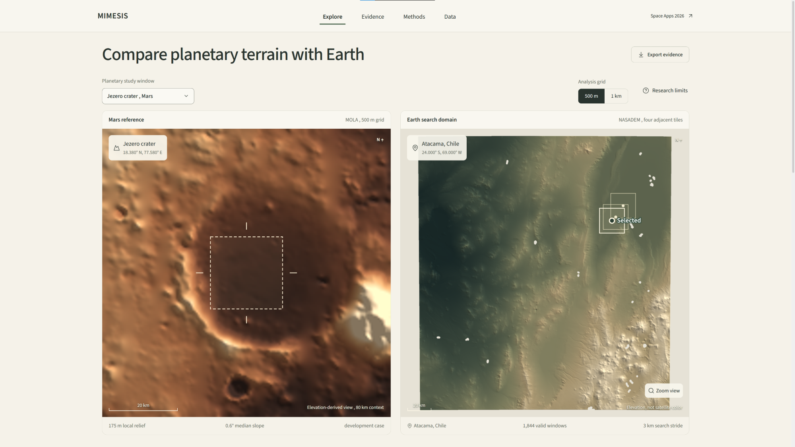
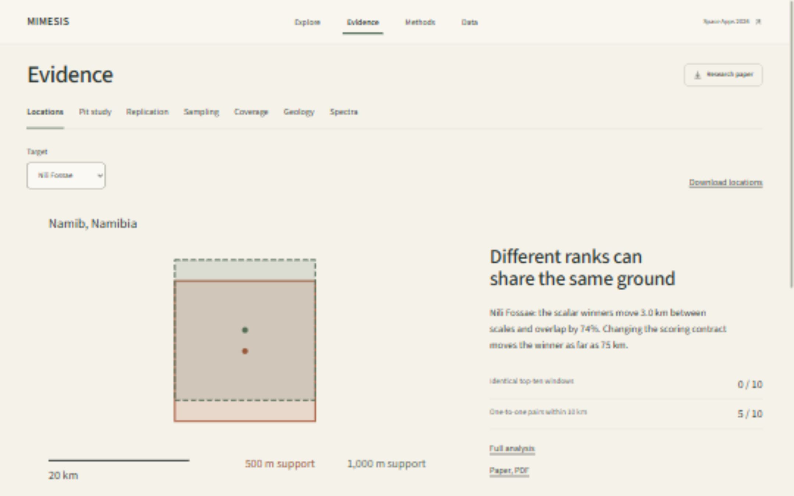
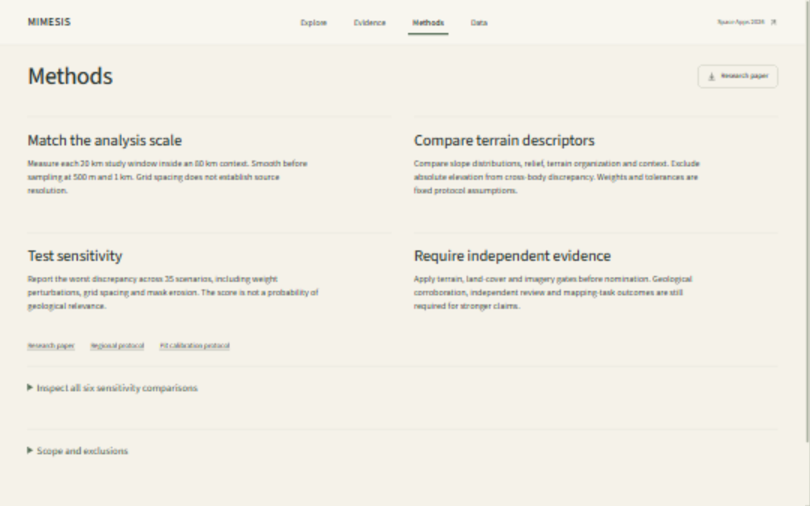
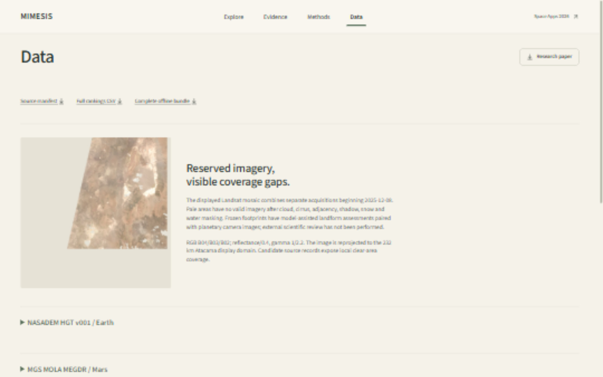
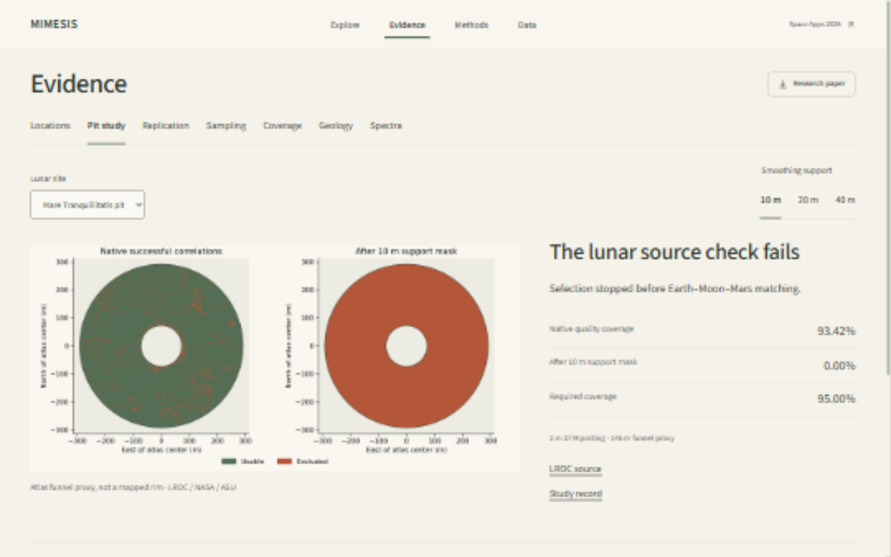

# MIMESIS

MIMESIS helps researchers find Earth locations for testing equipment and studying terrain before Moon and Mars exploration. It compares NASA height maps and shows the measurements behind each possible match.

Built by [Arjun Vijay Prakash](https://arjuncodess.is-a.dev/), Grade XI, City Montessori School, Kanpur Road, Lucknow, India, for NASA Space Apps 2026.

## What we found

We compared 3,693 overlapping Earth areas in the Namib and Atacama with six locations on the Moon and Mars.

- For Nili Fossae, changing map scale replaced every entry in the top ten. Yet the winning Earth areas were only three kilometres apart and covered much of the same ground.
- Changing the comparison method moved the choices for Jezero and Syrtis between Namibia and Chile, more than 8,300 kilometres.
- Our lunar pit quality checks failed, so that comparison stopped before selecting an analogue.

The suggested locations are research candidates. Geological review and field checks are still needed to confirm what each place can teach us.

## Explore the project





<details>
<summary>Methods, data and lunar quality checks</summary>

### Methods



### Data



### Lunar quality check



</details>

## Research and downloads

- [Research paper](artifacts/paper/mimesis-paper.pdf), with methods, results, source references and limitations.
- [Location maps](apps/web/public/research/site-shortlist.geojson) and [measured results](artifacts/reports/site_stability.json).
- [Project submission](artifacts/submission/submission.md), including the summary and judging-criteria evidence.
- [Seven-slide pitch](artifacts/presentation/mimesis-pitch.pdf) and [editable presentation](artifacts/presentation/mimesis-editable.pptx).

## Data

The main comparison uses NASADEM for Earth, MOLA for Mars and LOLA for the Moon. Supporting investigations use LROC, HLS, EMIT, USGS imagery and terrain, ESA WorldCover, Copernicus DEM and IGN terrain. Contains modified Copernicus data. The paper and source records retain product details, citations and provider terms.

OpenStreetMap-derived records credit [OpenStreetMap contributors](https://www.openstreetmap.org/copyright). Puga spectra come from the published datasets [3992541](https://doi.org/10.5281/zenodo.3992541) and [6304000](https://doi.org/10.5281/zenodo.6304000), CC BY 4.0.

The NASA Planetary Pits and Caves Analog Dataset is by Uland Wong, Warren Whittaker, Heather Jones and Red Whittaker, December 2014. Original cave surveys remain outside the public repository because their research-use terms do not authorize public database redistribution. Original climate inputs with unresolved redistribution terms are also excluded.

## Development

Python 3.11+ and Node.js 22+ are required. The application uses Python/FastAPI and React/TypeScript.

```sh
python -m pip install -e ".[test]"
python scripts/prepare_checkout.py
npm ci
npm run build
python -m uvicorn services.api.main:app --host 127.0.0.1 --port 8000
```

Open **http://127.0.0.1:8000**. Use `npm run dev` for frontend work, `python -m pytest -q` for the focused tests, and `python scripts/measure_site_stability.py` to reproduce the geographic analysis from the supplied records. Native downloads are needed for rebuilding the original terrain measurements. [Presentation build instructions](artifacts/presentation/README.md) are included separately.

## SI tool use

OpenAI Codex assisted with code, data-processing scripts, analysis design, debugging, literature review, website and presentation layouts, and writing. This includes editing the paper, README, pitch and submission text. Model-assisted visual interpretations are identified in the evidence records and remain provisional.

The original observations come from the cited datasets. SI tools did not generate the source terrain observations or replace missing measurements with invented data. The website screenshots are actual captures supplied by Arjun Vijay Prakash. No SI-generated imagery or audio is included, and no NASA logos or branding were generated or modified.

The software is [MIT licensed](LICENSE). Source data retain their own terms. Independent geological review and NASA endorsement are not claimed.
